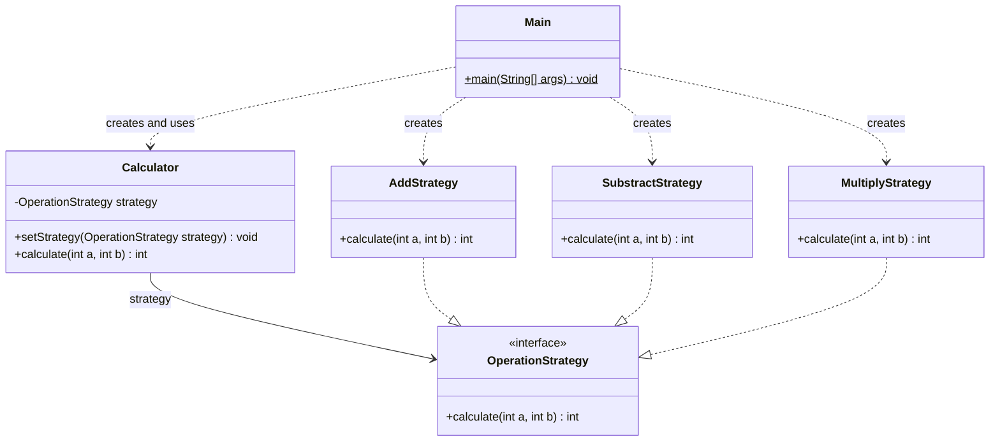

# Assignment #5 — Strategy Pattern Calculator

**Student:** NIYALOV YERKEBULAN  
**Group:** SE 2526

## Overview

This Java project demonstrates the Strategy design pattern using an integer calculator. It supports addition, subtraction, and multiplication through interchangeable operation classes.

The client selects an operation with `setStrategy(...)`. The calculator then delegates the calculation to that strategy through the `OperationStrategy` interface.

## Design

| Pattern role | Class or interface | Responsibility |
|---|---|---|
| Context | `Calculator` | Stores the selected strategy and delegates calculations. |
| Strategy | `OperationStrategy` | Declares `int calculate(int a, int b)`. |
| Concrete Strategy | `AddStrategy` | Returns the sum of two integers. |
| Concrete Strategy | `SubstractStrategy` | Subtracts the second integer from the first. |
| Concrete Strategy | `MultiplyStrategy` | Returns the product of two integers. |
| Client | `Main` | Creates objects, selects strategies, and prints results. |

`SubstractStrategy` preserves the class name used in the implementation.

## UML Class Diagram



The link from `Calculator` to `OperationStrategy` is an ordinary directed association. The three concrete strategies realize the interface. `Main` depends on the classes it creates and uses.

## Source Files

- `Main.java` — application entry point.
- `Calculator.java` — calculator context.
- `OperationStrategy.java` — common operation interface.
- `AddStrategy.java` — addition algorithm.
- `SubstractStrategy.java` — subtraction algorithm.
- `MultiplyStrategy.java` — multiplication algorithm.

## Requirements

- JDK 17 for compilation and execution.
- A terminal or Java IDE.
- No external libraries are required by the code shown in the project screenshots.

## Compile and Run

These commands apply to the shown implementation, where the six Java files have no package declarations. Open a terminal in the directory containing those files, then confirm that both tools report version 17:

```shell
java -version
javac -version
```

Compile the files and run the application. Run the final command only if compilation succeeds:

```shell
javac --release 17 -d out Main.java Calculator.java OperationStrategy.java AddStrategy.java SubstractStrategy.java MultiplyStrategy.java
java -cp out Main
```

If the Java files are in `src`, enter that directory before using these commands. The `out` directory contains generated class files and should not be committed as source code.

## Current Demonstration

`Main` creates one calculator and three strategy objects. It first selects addition and calculates with operands `10` and `5`. It then selects multiplication on the same calculator and calculates with the same operands.

Expected output for this demonstration:

```text
15
50
```

The subtraction strategy is implemented and instantiated, but the shown `Main` does not select or execute it.

## Suggested Verification

The following are expected results for student-run checks, not recorded test results:

| Operation | First operand | Second operand | Expected result |
|---|---:|---:|---:|
| Addition | 10 | 5 | 15 |
| Subtraction | 10 | 5 | 5 |
| Multiplication | 10 | 5 | 50 |
| Subtraction | 5 | 10 | -5 |
| Addition | -3 | 2 | -1 |
| Multiplication | 0 | 9 | 0 |

To check runtime switching, select addition, subtraction, and multiplication in turn on the same `Calculator` object and calculate after each selection.

## Clean Code

- Class and method names describe their roles and operations.
- Each arithmetic method performs one small calculation.
- Calculation logic is separate from console output.
- The selected strategy is stored in a private field.
- `Calculator` delegates through an interface instead of checking concrete operation types.

## Limitations

- A non-null strategy must be selected before calling `calculate`. The shown implementation does not validate this condition; an unset or null strategy causes `NullPointerException` when used.
- Calculations use Java `int` values. Arithmetic overflow is not checked.
- The demonstration uses fixed operands and has no interactive input.
- The class name `SubstractStrategy` contains a spelling error; a correction would require updating the file name and all references consistently.

## Documentation and Verification Status

This README was prepared with AI assistance from the student's supplied code screenshots. It describes that visible implementation; the source files were not compiled or executed during preparation of this document. Compatibility with JDK 17 still requires an actual project run. No repository upload or course submission is claimed.

AI assistance was used for reference explanations and documentation drafting. Use of this document must remain within the assignment's AI policy; authorship of the implementation and responsibility for the final submission remain with the student.
